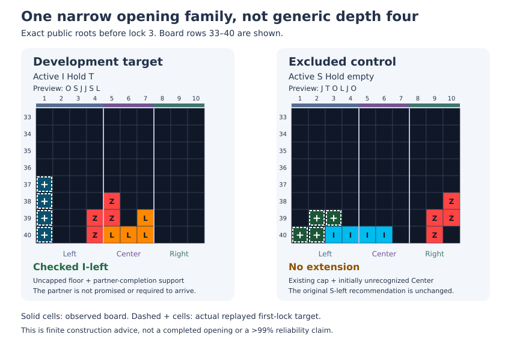

# Development block review, October 24–25, 2026

## Retained changes

1. **Earlier certified cap backup and cheaper necessary checks.** Cleanup
   qualification rejects non-I and wrong-column placements before full
   transition analysis, while retaining actual empty-HOLD I cases. A fully
   certified exact Z cap can be kept before optional preparation, but cannot
   override ordinary advice, a saved goal or I cleanup. In four matched
   1500 ms pairs, all 794 locks were unchanged: 21 backups were verified and
   zero selected. Benefit is demonstrated by deterministic low-budget rescue
   tests, not an observed long-run rescue in that cohort.
2. **Honest work accounting.** Opt-in maintenance telemetry reports inclusive
   preprocessing costs. Selected Z-deferral costs retain prior search work;
   final rejected or unknown access checks charge their visited nodes and clear
   selection flags. Timing boundaries are not additive causal attribution.
3. **One-lock level-two S re-entry.** The exact phase-aligned level-two base may
   restore a supported Center with one certified S. Existing goals, actual
   executable Z caps, notches, cavity/access checks and resource obligations
   remain protected. A matched target improves from 98 to 102 locks with one
   extra T-spin double; the other three streams are unchanged. The inherited
   Left gap remains, and the later uneven base still abstains.
4. **Narrow uncapped opening root ambiguity.** On open-floor construction with
   geometric partner-completion support, preserve at most two strategically
   tied root shapes and optionally compare one complete additional lock layer.
   Symmetric group membership keeps the target stable during input movement;
   no score bonus, fixed piece sequence or new repair commitment is imposed.
   In the final five fresh pairs, the thin-Center target improves 25→68 locks
   and 0→14 lines. All four regression streams remain exactly unchanged.

The last comparison totals 426→469 locks and 4→5 handoffs, with joint milestones
unchanged at 3/5. All 895 locks replayed; there were no invalid recommendations,
watchdog failures or censored episodes. Only the intended I3 request attempted
or selected the new extension. Three later maintenance calls still exceeded the
1500 ms soft limit slightly, reaching 1548 ms. The 750 ms restoration goal remains
open, and the >99% objective has not been met.

## Failed experiments remain part of the result

The broader root-ambiguity version was rejected: 426→303 locks and 3→1 joint
milestones. A directly affected capped-root stream fell 102→13. Another stream
fell 106→29 without using the feature; its first-move difference coincided with
changed timed foundation-stage coverage, but causality was not isolated. The
narrowed trial is a separate declared cohort, not a retry replacing those losses.

The prior global maintenance flood optimization also remains reverted despite
fixed-node equivalence, because its timed outcomes were mixed and sometimes
severely worse. Only opening uses that optimized minimal query. No Reset coach,
safety relaxation or quota was added in this opening segment. The subsequently
authorized [regional mino ledger](st-regional-mino-ledger.md) is separate offline
accounting, not a strategy change.

## Verification and publication

Runtime `8c61234` passed 578/578 behavioral cases and an exact-source 25-pose plus
two-HOLD-state lifecycle sweep. The temporary cold compilation cache preserves
fresh child/module and page isolation; test timeouts remain 15/120 seconds.
The earlier uncached aggregate cancellation is retained as a failed run. These
are development results, not a formal acceptance or independent reliability
sample. Visual controls below show exact public boards, not browser screenshots.

This block was not published. A read-only GitHub check at 00:08 UTC October 25
confirmed milestone branch head `68a250057517288a8a8488833e27d1146d943a53`, whose
tree `969bfeec042b9761ad5a7c37afa43f7969617c16` equals the earlier local `075c4c7`
checkpoint. Current development commits remain local, with the earlier PR #19
integration preserved. Local and published histories are distinct; do not
infer fast-forward publication from tree equality.

## Evidence

- [Budget, cap fallback and prior rejected optimization](st-temporary-planning-budget.md)
- [Exact level-base re-entry and matched results](st-level-base-reentry.md)
- [Root ambiguity, guards, failures, final comparisons and visual controls](st-opening-root-ties.md)
- [Rejected broader cohort](st-opening-root-ties-rejected-results-2026-10-24.json)
- [Retained narrow cohort](st-opening-root-ties-narrow-results-2026-10-24.json)

